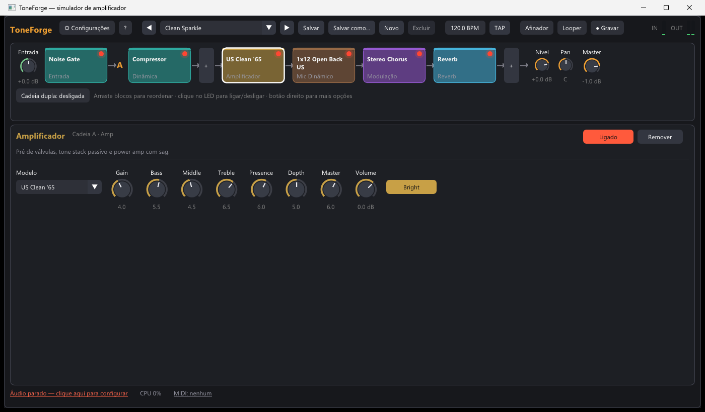

# ToneForge

> 🚧 **Em desenvolvimento.** Projeto pessoal e experimental: funciona, mas ainda
> muda bastante e pode ter bugs.

Simulador de amplificador de guitarra e baixo para Windows, inspirado no
**AmpliTube 5**: pedais, amps, gabinetes com microfone, rack de efeitos, cadeia
dupla, afinador, looper, gravação, presets e MIDI.



## Como foi feito

O ponto de partida foi entender como o AmpliTube 5 é organizado: quais blocos
existem e como a cadeia de sinal é montada. Para isso usei engenharia reversa
**apenas dos metadados do executável** (bibliotecas usadas e nomes de componentes),
com a ferramenta [REA](https://github.com/morluto/rea).

A partir disso, **todo o ToneForge foi escrito do zero** (*clean-room*):

- nenhum código, modelo de amp, IR, imagem ou preset da IK Multimedia foi copiado ou usado;
- não houve descompilação do processamento de áudio nem acesso ao sistema de licença;
- os amps e efeitos são modelos próprios, baseados em circuitos clássicos e
  técnicas de DSP publicadas, e usam nomes genéricos.

## Funcionalidades

| Área | O que tem |
| --- | --- |
| Cadeia de sinal | Entrada → Noise Gate → até 8 pedais → Amp → Gabinete → até 6 efeitos de rack → Master → Looper → Saída |
| Cadeia dupla | Duas cadeias completas (A e B) em paralelo, com nível e pan próprios; copiar A↔B |
| Amplificadores | 8 modelos: Tweed '57, US Clean '65, Brit Plexi '59, Brit Lead 800, Modern Hi-Gain, AC Chime, Bass Tube 300, Solid Clean 120. Pré de válvulas com 1–4 estágios, tone stack passivo (Yeh & Smith), power amp com sag, presence, depth e bright; oversampling 4x |
| Gabinetes | 6 modelos (1x12, 2x12, 4x12 Greenback, 4x12 V30, 1x15 e 8x10 de baixo), 3 microfones (dinâmico, ribbon, condensador), posição, distância, sala estéreo, cortes. Carrega IRs próprias (WAV/AIFF/FLAC) por convolução FFT particionada |
| Pedais e rack (23) | Compressor, Noise Gate, Volume; Green Overdrive, Rodent Distortion, Round Fuzz, Big Fuzz, Treble Booster, Clean Boost, Bit Crusher; Wah/Auto-Wah; Graphic EQ 7, EQ paramétrico; Chorus, Flanger, Phaser, Uni-Vibe, Tremolo/Pan, Rotary; Delay (digital/analógico/fita, ping-pong, sync); Reverb (room/hall/plate/spring); Octaver, Pitch Shifter/Whammy |
| Ferramentas | Afinador (YIN, ±0,3 cent), Looper estéreo de 60 s com overdub e desfazer/refazer, gravação da saída em WAV, tap tempo |
| Presets | 13 presets de fábrica nivelados em -18 dBFS RMS; presets do usuário em JSON |
| MIDI | Aprender MIDI em qualquer knob ou liga/desliga; funções globais (looper, afinador, presets, tap, cadeia B); Program Change troca preset |
| Áudio | WASAPI (compartilhado ou exclusivo), DirectSound e WinMM, escolha do canal de entrada |

## Compilar

Requisitos: MinGW-w64 (g++ 13 ou mais novo), CMake e Ninja.

```bash
cmake -S . -B build -G Ninja -DCMAKE_BUILD_TYPE=Release
cmake --build build
```

O resultado é `build/ToneForge.exe`, ligado estaticamente (não precisa de DLLs do MinGW).

## Usar

1. Abra `build/ToneForge.exe`. Na primeira vez as **Configurações** abrem sozinhas na
   aba Áudio: escolha a entrada da guitarra e a saída e clique em **Aplicar**.
2. Para mudar depois, clique em **⚙ Configurações** (ao lado do logo), use `Ctrl+,`
   ou clique no status de áudio no rodapé. Abas: **Áudio** (driver, dispositivos,
   canal, taxa, buffer), **MIDI** (controlador e mapeamentos) e **Interface**
   (tamanho da interface, afinador, pastas).
3. Para menor latência com interface de áudio, marque **WASAPI exclusivo** e use
   buffer de 64–128 amostras. No modo compartilhado, muitos drivers USB ficam presos
   em 480 amostras (~30 ms).
4. Clique num bloco para editar os knobs. Use **+** para adicionar pedais e efeitos,
   arraste blocos para reordenar, clique no LED para ligar/desligar e use o botão
   direito para mais opções (inclusive mapear MIDI).

Atalhos: `Ctrl+,` configurações · `Ctrl+=`/`Ctrl+-`/`Ctrl+0` tamanho da interface · `Ctrl+S` salvar · `PgUp`/`PgDn` presets · `T` afinador · `L` looper ·
`Espaço` Rec/Dub · `B` liga/desliga bloco · `Delete` remove bloco.

Arquivos: presets em `Documentos\ToneForge\Presets`, gravações em
`Documentos\ToneForge\Gravações`, configurações em `%APPDATA%\ToneForge\settings.json`.
A variável de ambiente `TONEFORGE_DATA` redireciona tudo para outra pasta (modo portátil).

## Testes

```bash
build/tf_selftest.exe renders
```

Renderiza todos os presets com um sinal de guitarra sintético (Karplus-Strong) e
grava WAVs em `renders/`, verifica NaN/Inf, clipping, nível e CPU, varre todos os
parâmetros de todos os módulos até os extremos, calibra os amps e testa o afinador,
o looper e a ida e volta de presets em JSON. `tf_selftest --audio-smoke` abre o
dispositivo padrão com a saída silenciada por 2 s para confirmar que o áudio roda.

## Estrutura

```
src/dsp/       filtros, oversampler, tone stack, convolução FFT
src/engine/    Module (base + registro), Rig (cadeias), Looper, afinador, presets
src/modules/   todos os efeitos, Amp.cpp e Cab.cpp
src/audio/     miniaudio (WASAPI/DirectSound/WinMM) e MIDI (WinMM)
src/app/       estado do app, configurações, gravador
src/ui/        interface Dear ImGui (knobs, cadeia, janelas)
tools/         autoteste offline
third_party/   miniaudio 0.11.25 (MIT-0) e Dear ImGui 1.92.9b (MIT)
```

Para criar um efeito novo: escreva uma classe derivada de `Module` com
`static const ModuleInfo& Info()`, `onPrepare()` e `process()`, e registre com
`TF_REGISTER(Classe);`. Ele aparece sozinho no menu **+**, nos presets e no MIDI.

## Limitações conhecidas

- Sem ASIO (o SDK da Steinberg tem licença própria); use WASAPI exclusivo.
- Sem versão plugin VST3/AAX: hoje é só standalone. O DSP é C++ puro e pode ser
  portado para JUCE.
- Os modelos de amp e gabinete são aproximações por circuito e filtros, não capturas
  de equipamentos reais. Para gabinetes mais realistas, carregue IRs (há muitas gratuitas).
- O som foi verificado por medição (níveis, estabilidade, CPU), não por audição.

## Próximos passos

Ideias anotadas em [IDEIAS.md](IDEIAS.md): carregar capturas NAM e IRs do TONE3000,
assistente de timbre com IA ("quero o timbre de tal música"), Tone Match com áudio
de referência e melhorias no afinador.

## Aviso legal

Projeto pessoal, não oficial e **sem nenhuma afiliação com a IK Multimedia**.
AmpliTube é marca registrada da IK Multimedia Production srl; o nome aparece aqui
só para indicar a inspiração. Outros nomes de equipamentos citados pertencem aos
seus respectivos donos e são usados apenas de forma descritiva.

## Licença

O código do ToneForge ainda não tem uma licença definida (todos os direitos
reservados). As bibliotecas incluídas em `third_party/` mantêm as próprias licenças:
[miniaudio](https://github.com/mackron/miniaudio) (domínio público ou MIT-0) e
[Dear ImGui](https://github.com/ocornut/imgui) (MIT).
